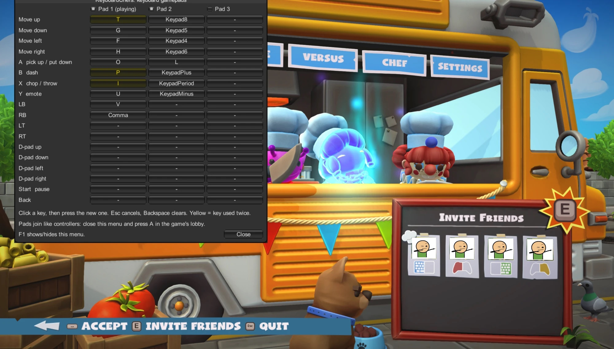

# KeyboardChefs

More Overcooked! 2 players on the keyboard. KeyboardChefs is a small BepInEx plugin that adds up
to three virtual gamepads inside the game, each driven by its own keys, so a third or fourth local
player can join without a controller.

- Players 1 and 2: the game's own split keyboard (WASD and arrows).
- Players 3 and 4: KeyboardChefs pads, set up in an in-game menu.



## Platforms

| Platform | Status |
|---|---|
| macOS (Apple Silicon, game runs under Rosetta) | tested on a MacBook Pro M4, macOS 26.6.2 |
| Linux | should work, not tested; install by hand (below) |
| Windows | should work, not tested; install by hand (below) |

The plugin is plain .NET 3.5 code, so the same `KeyboardChefs.dll` loads on every platform. Only
the BepInEx package and the way the game is launched differ. `install.sh` handles macOS only.

## How it works

Overcooked! 2 (Unity 2017.4) reads controllers through the InControl library. InControl accepts
devices created in code (`InputManager.AttachDevice`), and the game turns every attached device
into a joinable pad (`PCPadInputProvider.OnDeviceAttached`). Each KeyboardChefs pad is such a
device; every frame it reads its keys with Unity's `Input.GetKey` and reports them as gamepad
buttons and stick directions. No game file is modified; BepInEx loads the plugin at startup.

## Why not a system-wide virtual gamepad (macOS)

The first idea was a virtual HID gamepad that macOS and Steam see. That is not possible on a stock
Mac without Apple's approval:

- Creating a virtual HID device (`IOHIDUserDeviceCreateWithProperties`, CoreHID `HIDVirtualDevice`)
  requires the entitlement `com.apple.developer.hid.virtual.device`.
- Root does not bypass it: `IOHIDResourceDeviceUserClient::initWithTask` in Apple's IOHIDFamily
  source checks only for that entitlement (or an Apple-internal one), never for root.
- The entitlement is restricted. A binary that claims it without an Apple-issued provisioning
  profile is killed by AMFI at launch.
- Karabiner's signed DriverKit extension only offers a virtual keyboard and pointing device.
- The remaining route, disabling SIP and AMFI, weakens the whole Mac.

| Test on macOS 26.6.2 | Result |
|---|---|
| `IOHIDUserDeviceCreateWithProperties` as a normal user | returns NULL |
| same binary ad-hoc signed with the entitlement | killed at launch (exit 137, SIGKILL) |

So the pads live inside the game. Steam, the OS and other games never see them.

## Install on macOS

Download `KeyboardChefs-<version>.zip` from
[Releases](https://github.com/Mustangos/KeyboardChefs/releases), unzip it and run in Terminal:

```bash
bash ~/Downloads/KeyboardChefs-1.1.0/install.sh
```

It downloads BepInEx 5.4.23.5 for macOS (checksum-verified) into the game folder once and copies
`KeyboardChefs.dll` to `BepInEx/plugins/`. Set `OC2_DIR` if the game lives elsewhere.

Once, in Steam: Overcooked! 2 > Properties > Launch Options, paste the line `install.sh` prints:

```
"/Users/<you>/Library/Application Support/Steam/steamapps/common/Overcooked! 2/run_bepinex.sh" %command%
```

Without it the game starts without the plugin. Starting `run_bepinex.sh` by hand also loses the
plugin, because the game restarts itself through Steam (unless `SteamAppId=728880` is set).

### From source

In a clone of this repository without a prebuilt DLL, `install.sh` compiles `KeyboardChefs.cs`
against the game's own assemblies. That needs a .NET SDK, e.g. without sudo:

```bash
curl -sSL https://dot.net/v1/dotnet-install.sh | bash -s -- --channel LTS --install-dir ~/.dotnet
./install.sh
```

Re-run `./install.sh` after editing the source.

## Install on Linux or Windows (untested)

1. Install BepInEx 5 (x64) into the Overcooked! 2 folder as the
   [BepInEx docs](https://docs.bepinex.dev/articles/user_guide/installation/index.html) describe.
   On Linux this includes the `run_bepinex.sh` Steam launch option.
2. Copy `KeyboardChefs.dll` from the release zip to `BepInEx/plugins/` and start the game.

## Install with an AI coding agent

Paste this into an agent that can run commands on your computer (Claude Code, Codex and similar):

```
Install the KeyboardChefs plugin for Overcooked! 2 on this computer, following the README at
https://github.com/Mustangos/KeyboardChefs. Use the latest release zip, install BepInEx 5 into
the game folder, put KeyboardChefs.dll into BepInEx/plugins and tell me the Steam launch option
to set. Ask me before downloading or installing anything, and do not modify the game's own files.
```

## Use

`F1` (`fn+F1` on a MacBook) opens and closes the KeyboardChefs menu. For 10 seconds after the game
starts, a hint at the top left names the key.

- Tick **Pad 1 / 2 / 3** to plug a pad in, untick to unplug it.
- Click a key, then press the new one. `Esc` cancels, `Backspace` clears.
- Yellow keys are used twice: by another pad or by the game's own keyboard controls. Hover one to
  see where.
- Pads send nothing while the menu is open. Close it, then join in the lobby by pressing the pad's
  A key, like with a real controller.
- On macOS a small white cross marks where clicks land. Aim with it, not with the mouse pointer
  (see Known limitations).

Settings are saved to `BepInEx/config/keyboardchefs.cfg` in the game folder.

### Default keys

| Control | Pad 1 | Pad 2 (numeric keypad) |
|---|---|---|
| Move up / down / left / right | `T` / `G` / `F` / `H` | `8` / `5` / `4` / `6` |
| A (pick up / put down) | `O` | `0` |
| B (dash) | `P` | `+` |
| X (chop / throw) | `I` | `.` |
| Y (emote) | `U` | `-` |
| LB / RB | `V` / `,` | |

Pad 1 is on by default; pads 2 and 3 start unplugged. The game's split keyboard uses WASD, E, T,
Tab, Left Shift/Control/Alt (player 1) and the arrows, Right Shift, Right Alt, `/`, `I`, `P`,
keypad Enter (player 2), so pad 1 shares `T`, `I` and `P` with them. Rebind either side to
separate them.

## Config file options

`[General]` in `keyboardchefs.cfg`:

| Option | Default | Meaning |
|---|---|---|
| `MenuKey` | `F1` | shows/hides the menu |
| `ShowMenuOnStart` | `false` | opens the menu when the game starts instead of showing the hint |
| `LogKeys` | `false` | logs the Unity `KeyCode` name of every key press |
| `SelfTest` | `false` | debug: pulses A on pad 1 until the game engages it and saves `BepInEx/selftest.png` |

`[Pad1]` to `[Pad3]` hold `Enabled` and one Unity `KeyCode` name per control (`None` = unused).

## Logs

`BepInEx/LogOutput.log` in the game folder:

- `Pad N attached.`: InControl has the device.
- `Overcooked registered pad N.`: the game sees it as a pad.
- `Overcooked engaged pad N as ...`: the pad joined as a player.
- warnings name keys that are used twice.

## Uninstall

Remove the Steam launch option. To remove everything, delete `BepInEx/`, `run_bepinex.sh`,
`libdoorstop.dylib`, `.doorstop_version` and `changelog.txt` from the game folder.

## Known limitations

- Works only in Overcooked! 2. Steam, the OS and other games do not see the pads.
- Pad keys are not hidden from the game. Pick keys the keyboard players do not use.
- Keys work only while the game window is focused; losing focus releases every control.
- Key names follow Unity's `KeyCode`. On non-US layouts check them with `LogKeys`.
- In fullscreen on a MacBook with a notch, the game's Unity 2017 places the mouse about half the
  notch height (some 20 points) above the real pointer. The menu draws a white cross where Unity
  sees the mouse, so clicks still land.
- Overcooked! 2 has four local player slots, so at most two pads are useful next to a split keyboard.
- A game update that changes InControl or `PCPadInputProvider` can break the plugin.

## Test results

v1.0 (single pad), macOS 26.6.2, 2026-10-29:

| Check | Result |
|---|---|
| BepInEx loads under Rosetta | yes |
| Pad attached, registered and engaged by the game | yes, from the plugin log (`SelfTest`) |
| Steam launch option loads the plugin | yes |
| Three players (split keyboard + pad) playing a level | yes, played by hand |

v1.1 (menu, up to three pads), same Mac, 2026-10-29:

| Check | Result |
|---|---|
| Menu hidden at game start, hint names `F1` | yes, in-game screenshot (`SelfTest`) |
| Menu (`ShowMenuOnStart`) opaque, shows the keys of all three pads | yes, in-game screenshot (`SelfTest`) |
| Keys shared with the game's keyboard controls are marked yellow and logged | yes (`T`, `I`, `P` on pad 1) |
| Pads 1 and 2 attached and registered by the game at once | yes, from the plugin log |
| Pad 1 engaged as a player | yes, from the plugin log (`SelfTest`) |
| White cross on macOS sits inside the control Unity highlights under the mouse | yes, in-game screenshot |
| Opening with `F1`, rebinding by click, ticking pads | yes, by hand |
| Playing a level with two pads | not tested yet |

## License

MIT, see [LICENSE](LICENSE). Not affiliated with Team17 or Ghost Town Games. Overcooked! 2,
InControl and BepInEx belong to their respective owners; this repository contains none of their code.
